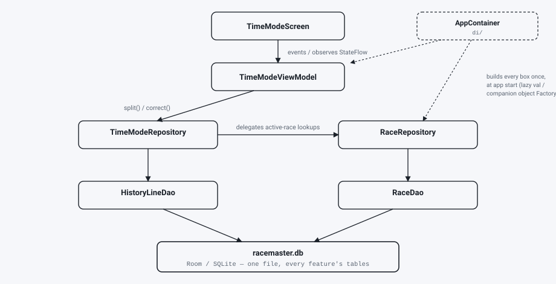
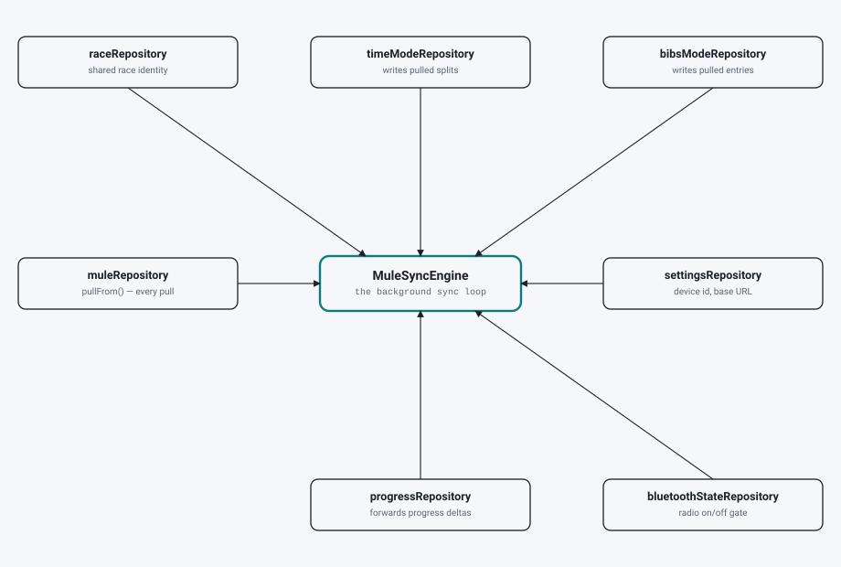
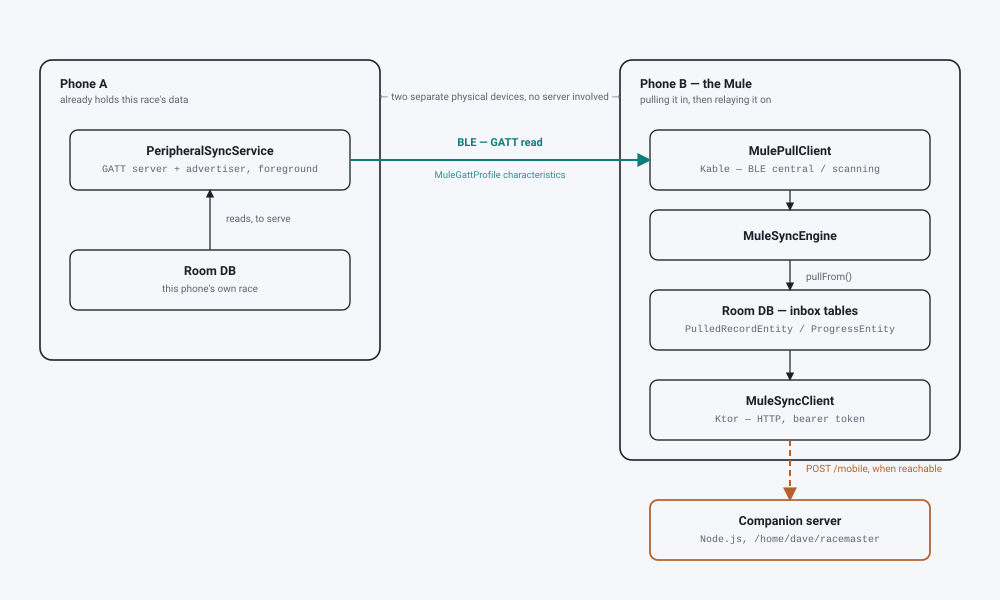

# Architecture diagrams

> **Snapshot, not a live view.** Drawn 2026-10-29 against commit `6acca1b`. These trace specific
> classes and constructor wiring as they existed at that point — names, fan-out, and call chains
> drift as the code changes. Before relying on a specific detail here (a class name, which
> repository depends on which), check it against the current source; `di/AppContainer.kt` is the
> ground truth for every wiring claim below. Regenerate by asking Claude to redraw them from the
> current `AppContainer.kt` / `MuleSyncEngine.kt` / `PeripheralSyncService.kt`.

These render light/dark depending on your browser's/OS's color-scheme preference, not GitHub's
own light/dark toggle — the two usually agree (GitHub defaults to "sync with system") but can
disagree if you've pinned GitHub's theme independently of your OS.

## 1. An ordinary feature's call chain (Time Mode)

Every other feature (Bibs Mode, Race History, ...) follows this identical shape — only the names
change. The one real wrinkle: `TimeModeRepository` and `BibsModeRepository` both hold their own
reference to `RaceRepository` rather than going through each other. See `STRUCTURE.md`'s own
"big picture" ASCII diagram for the prose version of this same flow.

## 2. Why Mule Mode's background engine touches seven repositories at once

Every other ViewModel in this app holds one, occasionally two, repositories. `MuleSyncEngine`
holds seven, simultaneously, because its one job — keep race data moving between phones in the
background, regardless of what screen is open — genuinely needs to read and write all of them.
Not accidental layering; one background loop with a wide job description.

## 3. How race data actually crosses a device boundary

Both phones run the identical app — nothing pins one as permanently "server" and one as "mule."
Whichever phone currently has a race's data advertises it; any nearby phone's `MulePullClient`
can pull it. The HTTP leg to the companion server is a separate, optional hop that happens
whenever a phone regains network, independent of the BLE mesh.
